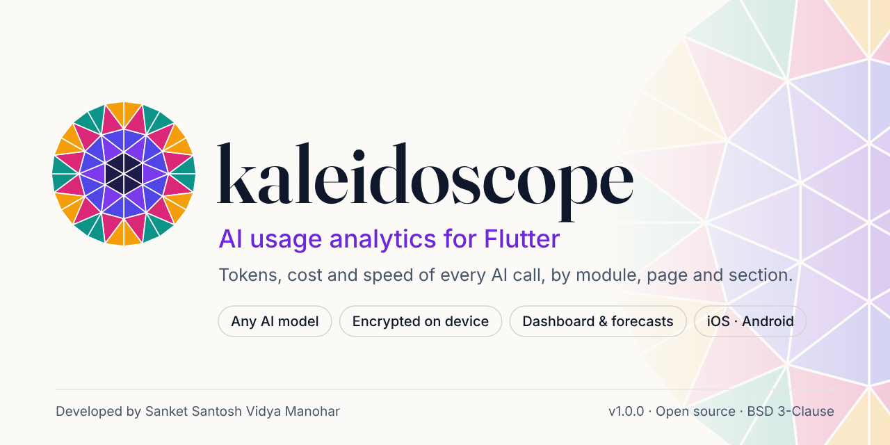
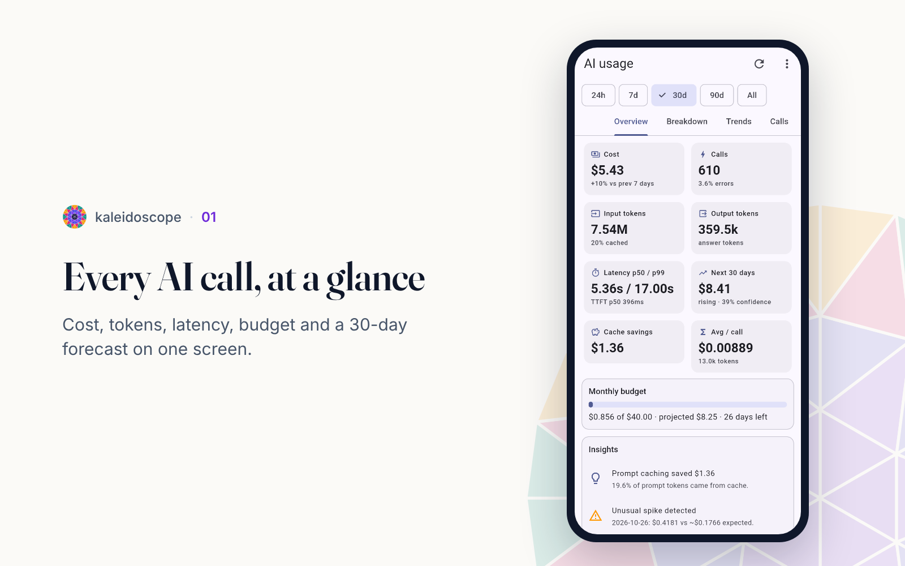
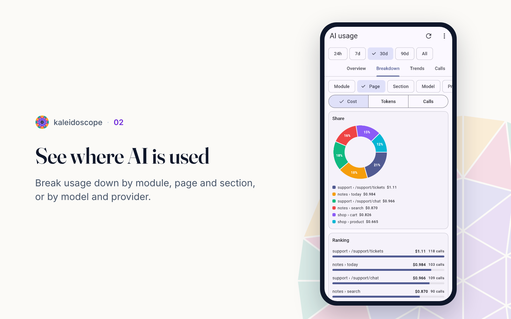
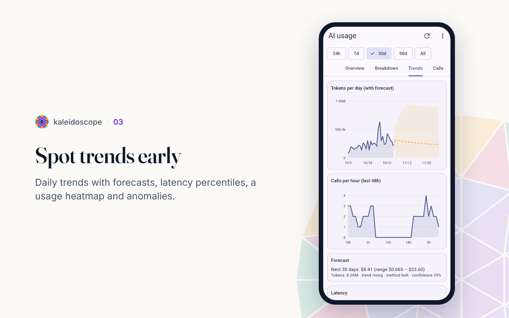
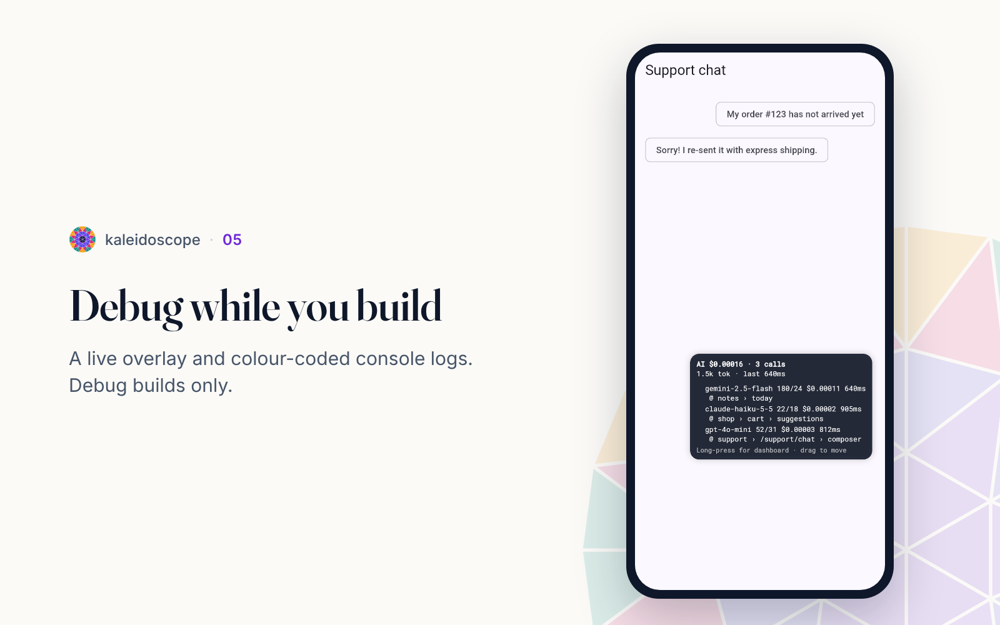

<p align="center">
  <picture>
    <source media="(prefers-color-scheme: dark)" srcset="doc/brand/png/banner-dark.png">
    
  </picture>
</p>

<p align="center">
  <a href="https://pub.dev/packages/kaleidoscope"></a>
  
  
</p>

<p align="center">
  <a href="#quick-start-3-steps">Quick start</a> ·
  <a href="#screenshots">Screenshots</a> ·
  <a href="#which-models-are-supported">Supported models</a> ·
  <a href="doc/kaleidoscope-guide.pdf">Full guide (PDF)</a> ·
  <a href="https://sanket-manohar.github.io/kaleidoscope">Website</a>
</p>

# kaleidoscope

**See exactly how your Flutter app uses AI.** Every call to **any model**
(OpenAI, Claude, Gemini, Mistral, Groq, DeepSeek, Ollama, on-device models or
your own gateway) is logged with its tokens, cost, speed, errors and the
**module, page and section** of your app it came from. Data is stored
**encrypted on the device**, and you get analytics, forecasts, charts and a
ready-made dashboard.

Your AI calls are never affected: if anything inside the tracker fails, the
call still goes through and returns exactly what it would have returned.

| | |
|---|---|
| Works with | any provider or SDK: HTTP client, Dio, or a one-line wrapper |
| Records | model, provider, parameters, input/output/cached/reasoning tokens, cost, latency, time to first token, errors, your tags and custom data |
| Storage | SQLCipher (AES-256) database, key kept in iOS Keychain / Android Keystore |
| Privacy | prompts not stored by default; `redacted` or `full` modes; PII scrubbing; retention limits |
| Analytics | totals, breakdowns by model/module/page/section, trends, forecasts, anomalies, budget, p50/p99 latency, insights |
| UI | `AIAnalyticsScreen`, chart widgets, floating debug overlay |
| Export | JSON, CSV, shareable HTML report; opt-in sync to your server, PostHog, Mixpanel, OpenTelemetry/Langfuse |

---

## Quick start (3 steps)

```yaml
dependencies:
  kaleidoscope: ^1.0.0
```

**1. Start it** in `main()`:

```dart
import 'package:kaleidoscope/kaleidoscope.dart';

Future<void> main() async {
  WidgetsFlutterBinding.ensureInitialized();
  await Kaleidoscope.init();
  runApp(const MyApp());
}
```

**2. Send your AI calls through it.** Pick whichever matches your code:

```dart
// a) package:http (also what most AI SDKs accept as `client:`)
final client = Kaleidoscope.httpClient();

// b) Dio
dio.interceptors.add(Kaleidoscope.dioInterceptor());

// c) Any SDK call at all
final res = await Kaleidoscope.track(
  provider: 'gemini',
  model: 'gemini-2.5-flash',
  call: () => model.generateContent([Content.text(question)]),
  usage: (r) => AITokenUsage(
    inputTokens: r.usageMetadata?.promptTokenCount ?? 0,
    outputTokens: r.usageMetadata?.candidatesTokenCount ?? 0,
  ),
);
```

**3. Look at the results:**

```dart
Kaleidoscope.openDashboard(context);
```

That's it. In debug builds every call is also printed to the console:

```
✔ [AI] openai/gpt-4o-mini chat @ support › /support/chat › composer • in 52 / out 31 • $0.000027 • 812ms
✔ [AI] anthropic/claude-haiku-5-5 chat (stream) @ shop › cart › suggestions • in 22 (+1200 cached) / out 18 • $0.000104 • 905ms (ttft 140ms)
✖ [AI] openai/gpt-4o chat • in 0 / out 0 • $0 • 233ms • error 429: Rate limit reached
```

---

## Tag where calls come from (module, page, section)

```dart
// Around any code. Works across awaits and for HTTP-intercepted calls.
await Kaleidoscope.scope(module: 'shop', page: 'cart', section: 'suggestions', () async {
  return client.post(url, body: body);
});

// Pages automatically from route names (`/shop/cart` -> module shop, page /shop/cart):
MaterialApp(navigatorObservers: [Kaleidoscope.navigatorObserver()]);

// Or in the widget tree:
AIUsageScope(module: 'shop', page: 'cart', child: CartPage());
// ...and inside: AIUsageScope.run(context, () => api.call(), section: 'suggestions');
```

Scopes nest and merge. You can also add `feature`, `userId`, `conversationId`,
`tags` and any `custom` key/values, then break analytics down by them.

---

## Which models are supported?

All of them. The HTTP client and Dio interceptor recognise these APIs by URL
path, so they work on any host, proxy or gateway:

| API | Examples |
|---|---|
| OpenAI-compatible (`/chat/completions`, `/responses`, `/embeddings`, ...) | OpenAI, Azure OpenAI, Groq, Mistral, DeepSeek, Together, OpenRouter, xAI, Perplexity, Fireworks, vLLM, LM Studio, LiteLLM, Helicone gateway |
| Anthropic Messages (`/v1/messages`) | Claude |
| Gemini (`:generateContent`, `:streamGenerateContent`) | Gemini API, Vertex AI |
| Ollama (`/api/chat`, `/api/generate`) | any local model |
| Cohere (`/v2/chat`) | Command models |

Streaming (SSE and NDJSON) is captured without changing what your code
receives, including time to first token. For anything else:

* your own endpoint: `KaleidoscopeConfig(additionalHostsToTrack: ['ai.mycompany.com'])`
  (a generic parser reads common usage fields), or register a custom
  `AIProviderAdapter` with `Kaleidoscope.instance.registerAdapter(...)`;
* any SDK: `Kaleidoscope.track(...)` / `Kaleidoscope.trackStream(...)`;
* on-device models (Gemini Nano, TFLite, ML Kit, MediaPipe, llama.cpp):
  `Kaleidoscope.instance.trackOnDevice(...)` (tokens estimated if not given);
* calls made by your backend: `Kaleidoscope.record(provider:, model:, inputTokens:, outputTokens:)`.

Ready-made usage readers for SDK responses: `UsageExtractors.openAI(json)`,
`.anthropic(json)`, `.gemini(json)`, `.ollama(json)`, `.cohere(json)`, `.auto(json)`.

---

## Prompt storage, privacy and retention

```dart
await Kaleidoscope.init(
  storePrompts: false,                         // default: metadata only
  // promptStorage: PromptStorageMode.redacted, // store text with PII removed
  keepFor: const Duration(days: 90),           // delete records older than this
  maxRecords: 50000,                           // and keep at most this many
  keepPromptTextFor: const Duration(days: 7),  // strip text earlier, keep usage
);
```

* **metadataOnly** (default): tokens, cost, model, params and tags, no text.
* **redacted**: text with emails, phone numbers, card numbers, API keys,
  bearer tokens and IPs replaced. Add your own `Redactor`s.
* **full**: complete text (still encrypted at rest).

Everything is stored in a SQLCipher-encrypted database. Its random 256-bit key
is generated on first launch and kept in the Keychain / Keystore. If secure
storage is unavailable the tracker falls back to memory and keeps working.

Use `beforeSave: (record) => ...` to change or drop records, and
`Kaleidoscope.instance.clearAll()` to wipe everything.

---

## Pricing (updatable at runtime or remotely)

Built-in prices cover 30+ models with prompt-cache discounts. Prices change, so:

```dart
// Change one price now (saved and reused on next launch)
Kaleidoscope.pricing.setPrice('gpt-4o*',
    const ModelPrice(inputPerMillion: 2.5, outputPerMillion: 10, cachedInputPerMillion: 1.25));

// Or keep prices in a JSON file you control and refresh daily
await Kaleidoscope.init(remotePricingUrl: Uri.parse('https://cdn.example.com/ai-prices.json'));
```

```json
{
  "version": "2026-11",
  "currency": "USD",
  "models": {
    "gpt-4o-mini*": { "input": 0.15, "output": 0.6, "cachedInput": 0.075 },
    "claude-sonnet-5*": { "input": 2, "output": 10, "cachedInput": 0.2, "cacheWrite": 2.5 },
    "ollama:*": { "input": 0, "output": 0 }
  }
}
```

Keys can be exact names or patterns (`gpt-4o*`, `*-mini`, `provider:*`); the
longest match wins. Any currency works. Estimate before sending:

```dart
final e = Kaleidoscope.estimate(model: 'gpt-4o', prompt: longText, expectedOutputTokens: 500);
print(e); // gpt-4o: ~1250 in / ~500 out ≈ 0.008125 USD
```

---

## Analytics API

```dart
final a = Kaleidoscope.analytics;

await a.summary(from: DateTime.now().subtract(const Duration(days: 7)));
await a.breakdown(UsageDimension.module);          // also model, provider, page,
await a.breakdown(UsageDimension.fullPath);        // section, feature, user...
await a.breakdown(UsageDimension.module, customKey: 'plan'); // your custom field
await a.moduleTree();                              // module › page › section
await a.timeSeries(TimeBucket.day);
await a.latency();                                 // p50/p90/p95/p99, TTFT, tokens/s
await a.forecast(metric: 'cost', days: 30);        // trend + 95% band
await a.anomalies();                               // unusual days
await a.budget(25);                                // spend vs budget, projection
await a.compare(const Duration(days: 7));          // this week vs last
await a.insights();                                // plain-language findings
final report = await a.report();                   // everything at once (toJson())
```

Every method takes `from`, `to` and a `UsageQuery` filter (provider, model,
module, page, section, status, search). Raw data: `Kaleidoscope.records(UsageQuery(...))`.

---

## UI

```dart
// Full dashboard: overview, breakdowns, trends/forecast, searchable call log,
// export (JSON / CSV / HTML) and delete. Debug builds only unless you allow it.
AIAnalyticsScreen(accessPin: '2580', allowInRelease: true);

// Floating live cost/speed bubble, hidden automatically in release builds.
MaterialApp(
  navigatorKey: navKey,
  builder: (context, child) => AIUsageDebugOverlay(navigatorKey: navKey, child: child!),
);

// Build your own screens with the chart widgets:
AIUsageLineChart(points: report.daily, forecast: report.costForecast);
AIUsagePieChart(items: report.byModel);
AIUsageBarList(items: report.byPage);
AIUsageHeatmap(grid: report.heatmap);
AIStatCard(label: 'Cost', value: AIFormat.money(report.totals.cost));
```

---

## Export and integrations (all opt-in)

```dart
final html = await Kaleidoscope.exportHtml();   // shareable report, no scripts
final csv  = await Kaleidoscope.exportCsv();
final json = await Kaleidoscope.exportJson();

Kaleidoscope.addSink(ServerSyncSink(endpoint: Uri.parse('https://api.you.com/ai-usage')));
Kaleidoscope.addSink(PostHogSink(apiKey: 'phc_...'));
Kaleidoscope.addSink(MixpanelSink(projectToken: '...'));
Kaleidoscope.addSink(OpenTelemetrySink(tracesEndpoint: Uri.parse('https://otel.you.com/v1/traces')));
Kaleidoscope.addSink(OpenTelemetrySink.langfuse(publicKey: 'pk-lf-...', secretKey: 'sk-lf-...'));
Kaleidoscope.addSink(CallbackSink('firebase', (batch) async { /* anything */ }));
```

Sinks batch records, keep them on the device while offline (survives
restarts), and retry with backoff. They send metadata only unless you set
`includeText: true` (text is PII-scrubbed). OpenTelemetry spans follow the
GenAI semantic conventions (`gen_ai.*`). Helicone works by pointing your
client's base URL at the Helicone gateway; calls are still tracked.

A dependency-free receiver for `ServerSyncSink` is in
[`example/server/`](example/server/).

---

## Optional: provider fallback

```dart
final router = AIFallbackRouter();
final answer = await router.run([
  AIRoute(provider: 'openai', model: 'gpt-4o', call: () => openAi.ask(q)),
  AIRoute(provider: 'anthropic', model: 'claude-sonnet-5-5', call: () => claude.ask(q)),
]);
```

Failed attempts are logged; a provider that keeps failing is skipped for a
cool-down period. If those calls already go through the tracked HTTP client,
pass `trackAttempts: false` to avoid counting them twice.

---

## All options

`Kaleidoscope.init(config: KaleidoscopeConfig(...))` exposes everything:

| Option | Default | What it does |
|---|---|---|
| `enabled` | `true` | Master switch |
| `promptStorage` | `metadataOnly` | `metadataOnly`, `redacted`, `full` |
| `maxStoredTextLength` | `20000` | Truncate stored text |
| `redactors` | built-in set | PII patterns |
| `retention` | 90 days / 50k records | `RetentionPolicy(maxAge, maxRecords, textMaxAge)` |
| `debugLog` | `summary` | `AIDebugLogConfig(level, useColors, showPromptText)` |
| `store` | encrypted SQLite | Any `UsageStore` (e.g. `InMemoryUsageStore` for tests) |
| `pricing` | built-in | Your own `PricingTable` |
| `remotePricingUrl` | none | JSON price list refreshed every `pricingRefreshInterval` |
| `estimateMissingTokens` | `true` | Estimate when a provider reports no usage (flagged `estimated`) |
| `injectStreamUsageOption` | `false` | Ask OpenAI-compatible streams to include usage |
| `additionalHostsToTrack` / `ignoredHosts` | none | Control what the interceptors inspect |
| `beforeSave` | none | Edit or drop records |
| `onError` | none | Get the tracker's own internal errors (e.g. to Crashlytics) |
| `defaultContext` | none | Tags added to every record |
| `monthlyBudget` | none | Budget tracking and alerts |

---

## Platform setup

* **Android**: `minSdkVersion 23` or higher (required by secure storage).
* **iOS**: iOS 13+. Nothing else to configure.
* The package uses `sqflite_sqlcipher`. If your app also depends on plain
  `sqflite`, see the sqflite_sqlcipher README about using one SQLite library.

## Testing your app

```dart
await KaleidoscopeTracker.instance.initialize(
    KaleidoscopeConfig(store: InMemoryUsageStore(), debugLog: AIDebugLogConfig.off));
```

## Example

[`example/`](example/) runs without API keys and shows each integration style,
tagging, streaming, on-device tracking, fallback, sample data and the dashboard.

---

## Screenshots

<p align="center">
  
  
  
  
</p>

## Documentation

The step-by-step guide for beginners, with screenshots, is in
[`doc/kaleidoscope-guide.pdf`](doc/kaleidoscope-guide.pdf).

## Author

**kaleidoscope** is designed and developed by **Sanket Santosh Vidya Manohar**.

* Website: [sanketmanohar.com](https://sanketmanohar.com/)
* GitHub: [github.com/sanket-manohar](https://github.com/sanket-manohar)
* pub.dev packages: [sanketmanohar.com on pub.dev](https://pub.dev/publishers/sanketmanohar.com/packages)
* VS Code extensions: [Visual Studio Marketplace](https://marketplace.visualstudio.com/publishers/sanket-manohar)
* YouTube: [@sanketmanoharstudio](https://www.youtube.com/@sanketmanoharstudio)
* Instagram: [@sanketmanoharstudio](https://www.instagram.com/sanketmanoharstudio/)

Issues and ideas are welcome on the
[issue tracker](https://github.com/sanket-manohar/kaleidoscope/issues).

## Disclaimer

kaleidoscope is a free, **experimental** open source project, shared for
learning and evaluation. Use it at your own risk: it comes with no warranty,
no support obligation and no liability of any kind.

kaleidoscope is an independent open-source project. It is **not affiliated
with, endorsed by or sponsored by** OpenAI, Anthropic, Google or any other AI
provider or company mentioned here. All product names, logos and brands are
the property of their respective owners and are used for identification only.

Token counts, costs, prices, forecasts and other figures can be incomplete,
estimated or out of date. **Always cross-check them with your provider's
official usage dashboard and invoices** before relying on them. See the full
[Terms and Conditions](TERMS.md).

## Contributing

Contributions are welcome. See [CONTRIBUTING.md](CONTRIBUTING.md), the
[Code of Conduct](CODE_OF_CONDUCT.md) and the [security policy](SECURITY.md).

## License

BSD 3-Clause © 2026 Sanket Santosh Vidya Manohar. See [LICENSE](LICENSE).

